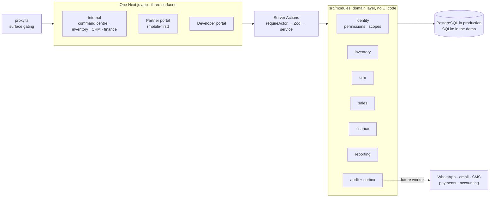
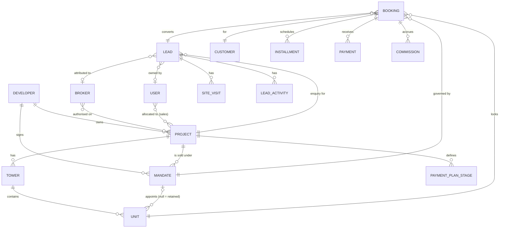
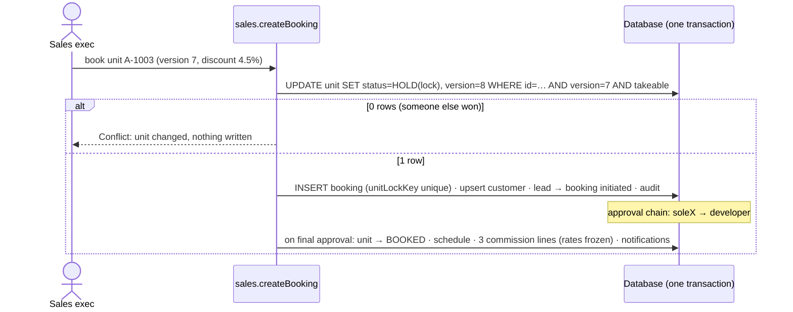

# soleX Round 2: demo report

**Prepared for:** the soleX evaluation team · **Demo:** working prototype in this repository ([README](../README.md) to run it, [DEMO_SCRIPT](DEMO_SCRIPT.md) for the walkthrough, [architecture diagrams](architecture.html) for every flow and dependency on one page)

## 1. What we built, in one paragraph

A small but genuinely working **mandate sales operating system**. A channel partner registers a buyer in the partner portal. The lead is auto-assigned to a soleX sales exec, who logs calls, runs a site visit and books a unit from a live stacking plan. A discount beyond the exec's authority goes to soleX management, and beyond the mandate's band also to the developer, inside the developer portal. The unit is locked meanwhile, then booked. A payment schedule is generated from the project's payment plan. Finance records receipts; when collections cross the mandate's earning trigger, the booking reaches agreement stage, the unit is marked sold and the commission lines (soleX fee receivable, partner brokerage and staff incentive payable) become earned and can be settled. Cancellation reverses all of it. The command centre, partner portal and developer portal show the same records, each through its own lens. Every step is real code against a real database; only external messaging and payment rails are simulated.

## 2. How we read the brief

The brief's key point is that **soleX is not a broker**. A broker CRM is organised around leads and listings. soleX's unit of business is the **mandate**: a contract with a developer to run the sales operation for appointed inventory, on agreed commercial terms, over a fixed term, against a target.

We therefore made the `Mandate` the centre of the data model, not an attribute on a project:

- **Appointed inventory:** a unit belongs to a mandate or to nobody. In *Aravali Greens*, tower C is retained by the developer. It shows hatched, and nothing can hold or book it.
- **Commercial terms live on the mandate:** soleX fee (with a performance tier), partner brokerage, staff incentive, discount bands, collection trigger, hold time, partner attribution window and cancellation forfeiture. Nothing is hard-coded per project (RFP §16).
- **Mandate health is the management view:** absorption against the pace needed to hit target by the end of the term, days left, booked value, collections, soleX fee, channel cost and **net margin per mandate**. A broker CRM cannot show this.

From the brief's menu we chose to connect **all five** demo options through one flow rather than build any of them deeply: management dashboard, project and inventory view, lead-to-booking workflow, **both** external portals, and the financial workflow. That puts two external stakeholders on the same records with different visibility, which demonstrates integration, confidentiality and transaction integrity together.

## 3. Technology stack and architecture

| Layer | Choice | Why |
| --- | --- | --- |
| App | Next.js 16 (App Router, Server Components, Server Actions), React 19, TypeScript strict | One deployable for web, partner and developer portals; server-rendered, so permission checks and data never depend on the browser |
| UI | Tailwind CSS 4 + shadcn/ui (Radix primitives) + Recharts | Accessible components we own; a small design system (status language, money and KPI components) |
| Data | Prisma 7 + SQLite for the demo; schema is PostgreSQL-ready | Zero infrastructure to run the demo; production target is managed PostgreSQL |
| Auth | Signed httpOnly session cookie (jose), bcrypt passwords | Real sessions without third-party services; the user is re-read from the DB on every request |
| Validation | Zod on every action input | One schema per command |
| Tests | Vitest (unit + integration on real SQLite), Playwright (multi-browser E2E) | Business rules are tested against a real database, journeys against the real UI |

### Why a modular monolith and not microservices



soleX's core need is **cross-module consistency**. A single booking touches inventory, CRM, the payment schedule, three commission lines, the audit trail and notifications, and must be all-or-nothing. In a modular monolith that is **one ACID database transaction**. With microservices it becomes a distributed saga with compensations, eventual consistency, several deployments and a platform team, none of which a growing single-team business should pay for on day one.

The modules are still separated in code: each domain module exposes service functions, UI code never touches the database directly, and modules call each other only through those functions. When scale justifies it, the parts with natural boundaries can be extracted (notification delivery, reporting/analytics read models, document storage, integrations) behind the same interfaces.

## 4. How the core entities relate



- **Developer → Project → Mandate → Unit.** The mandate decides which units soleX may sell and on what terms.
- **Lead → Booking → Customer.** A lead is an enquiry for a project, with its source, campaign and, if partner-sourced, a time-limited **attribution**. It becomes a booking for one unit, and the person becomes a `Customer` (one customer can own several bookings; the customer portal would hang off this).
- **Booking → Installments, Payments, Commissions.** The schedule is generated from the project's payment plan. Each booking produces up to three ledger lines with rates **frozen** from the mandate at accrual: the soleX fee (a receivable from the developer), partner brokerage and the staff incentive (payables).
- **AuditEvent** and **Notification** record every material change and every outbound message.

## 5. How inventory, bookings and financial records stay consistent

1. **One transaction per business command.** Booking, approving, recording a payment and cancelling each commit every side effect together or not at all.
2. **Optimistic locking on units.** Every status change goes through one function that updates *only if* the unit still has the version the user was looking at and is in an allowed state. If someone else got there first, zero rows change and the user sees "Unit A-1003 changed since you opened it. Refresh and try again." There is no last-writer-wins.
3. **A database backstop.** A live booking stores the unit id in a **unique** column (`unitLockKey`) that is cleared when the booking is cancelled or rejected. A second live booking on the same unit is impossible even if application code had a bug.
4. **Explicit state machines** for unit, lead, booking and commission. Illegal moves (sold → booked, paid → reversed) are rejected.
5. **Time-boxed holds** (from the mandate) lapse automatically. A pending approval places a non-expiring *approval lock*, so nobody can sell the unit while the developer decides.
6. **Snapshots:** the price breakdown is frozen on the booking and commission rates on each ledger line, so later price or mandate changes never rewrite history.
7. **Money is integer rupees and rates are basis points.** The last instalment absorbs rounding, so a schedule always sums exactly to the agreement value.
8. **Idempotent receipts:** a bank reference can be recorded once per booking.
9. **Cancellation is a reversal, not a delete.** The unit is released, open instalments are cancelled, unsettled commission is reversed, settled commission gets a negative **clawback** line, and the refund due is computed under the mandate's forfeiture term.
10. **Dashboards have no counters to drift.** Every figure is computed from the source rows.
11. **Live integrity checker:** six invariants (one live booking per booked unit, lock key consistency, schedule = agreement value, receipts = payments, agreement only after the trigger, commission = base × rate and consistent with booking state). They are shown on *Activity & integrity* and asserted after every integration test and E2E journey.



The concurrency case is tested three ways: two simultaneous service calls (exactly one wins), a stale-version call, and two real browser sessions racing for the same unit.

## 6. How confidential information is separated

Three layers, all on the server:

1. **Surface gating** (`proxy.ts`): partners can only enter `/broker`, developers only `/developer`, and internal roles only the internal app.
2. **Permissions:** a role → action matrix (`booking.create`, `discount.approve.developer`, `commission.approve` and so on), checked in every service before anything else. Paying out is separated from approving the payout (finance vs management).
3. **Row scope + field projection:** every query composes a scope filter for the actor, and each surface's read model selects only the fields that role may see. A record outside your scope returns **404, not 403**, so the system never confirms that it exists.

| Data | Management | Sales exec | Finance | Partner | Developer |
| --- | --- | --- | --- | --- | --- |
| Projects | all | allocated only | all | authorised only | own only |
| Inventory | all + who holds | allocated projects | all | appointed units, available / not available only | whole project incl. retained units, no holder names |
| Leads | all | own leads | – | own registrations, stage only | aggregate funnel counts only |
| Partner identity on a sale | yes | yes | yes | own only | "Channel partner", no name |
| soleX fee | yes | – | yes | **never** | yes (it is their payable) |
| Partner brokerage / staff incentive | yes | own incentive | yes | own brokerage | **never** |
| Customer contact details | yes | yes | yes | only what they registered | **never** |
| Duplicate-lead feedback | names the existing lead | names it | – | "already registered", not by whom | – |

These rules are enforced by tests: 10 access-control integration tests, plus an E2E journey that tries cross-tenant URLs, internal pages and another developer's MIS export.

## 7. How the system can grow

- **More projects, developers and cities:** data, not code. A new mandate brings its own commercial terms, payment plan and appointed units; reports and portals pick it up automatically. Mandate renewals and phase-wise mandates are already supported by the model (several mandates per project).
- **More users and teams:** role permissions are one matrix, so a "Sales Manager" or "Channel Manager" role is a configuration change. The next step is to store the matrix in the database with an admin screen (RFP §21). Team hierarchies and regions would extend the same scope builders.
- **More modules:** HR/payroll, marketing spend, documents and the customer portal plug into the existing records: attendance → incentives, campaign → lead source → booking (the campaign tag is already captured), `Customer` → customer portal.
- **Scale:** PostgreSQL with row-level locks (the conditional updates port unchanged), a background worker for the notification outbox and scheduled reports, read replicas or materialised views for analytics, object storage for documents. SQLite is only a demo convenience.
- **Integrations:** the outbox pattern is already in place. Every message is written in the same transaction as the business change, so a WhatsApp Business / email / SMS worker can deliver reliably later. Payment gateways and accounting/ERP would post into the same `Payment` and commission ledger.

## 8. Workflow decisions and the pain points they address

| Pain point (from the brief) | What the demo does |
| --- | --- |
| Manual coordination between teams | One record flows end to end: a partner's registration *is* the lead, the booking *is* the inventory change, the receipt *triggers* the commission. Nothing is re-keyed; notifications are generated automatically. |
| No visibility across projects | Command centre with mandate health against pace, drill-down from every number, an attention rail (approvals, overdue collections, expiring mandates, refunds) and partner and sales-team performance. |
| Partner disputes over who brought the buyer | First-come attribution with a mandate-defined protection window, and server-side duplicate detection on a normalised phone number. Competing partners are told "already registered", never by whom. Attribution that lapsed before booking carries no brokerage. |
| Discount leakage | Three-tier authority from the mandate: the exec's band, soleX management, then the developer. Live preview in the booking form; the unit is locked during approval. |
| Commission errors and paying too early | Commission is earned only after the collection trigger (paid on money in, not on paper bookings); rates are frozen; approval and payment are separate duties; cancellations claw back. |
| Developer reporting effort | Developer portal with live sales, collections, fee statement and one-click CSV MIS; developers approve over-band discounts in the same place. |
| Double bookings | Optimistic lock + unique database key, proven by tests. |

**Where we suggest changing the workflow.** The RFP lists booking statuses as available → booked → sold without defining "sold". We tied **SOLD and commission earning to money actually collected** (the mandate's trigger, e.g. 20%) rather than to booking. This protects soleX's cash and the developer relationship: no fee is invoiced on a booking that may still fall through.

## 9. What is real vs simulated

| Real (working code, tested) | Simulated / out of scope |
| --- | --- |
| Login, sessions, role gating, permissions, data scoping | WhatsApp/email/SMS delivery: messages are written to an outbox shown on *Activity*, marked "Simulated" |
| Lead capture, duplicate and attribution protection, auto-assignment, activities, visits | Payment gateway: receipts are entered by finance (as with bank statements today) |
| Holds, bookings, approvals (soleX + developer), cancellations, concurrency control | Brochure/floor-plan downloads in the partner portal (labelled) |
| Payment schedules, receipt allocation, earning trigger, commission ledger, settlement, clawbacks | Accounting/ERP posting, GST/TDS on commission invoices |
| Command centre, finance, partner and developer portals, CSV MIS export | Customer portal, HR/payroll, marketing spend, KYC/documents, AI features |
| Audit trail, integrity checker, 37 integration/unit tests + 5 E2E journeys | Production hosting, backups, monitoring, MFA/SSO |

The seed **replays six months of fictional history through the real services** (with an injectable clock) rather than inserting rows directly, so the demo data obeys exactly the rules a live user would.

## 10. Assumptions

1. Partner brokerage and staff incentives are paid **by soleX out of its fee**, so net margin = fee − brokerage − incentives. If developers pay partners directly, the payout lines move to the developer side of the ledger.
2. Agreement stage (unit SOLD, commission earned) is reached when cumulative collections reach the mandate's trigger percentage.
3. Attribution: the first partner to register a phone number for a project owns it for the mandate's window; direct (soleX marketing) leads are protected the same way.
4. One customer can hold several bookings; customers are matched on a normalised Indian mobile number.
5. Developers see that a sale was partner-sourced but not which partner, and never customer contact details.
6. Discount bands, hold time, forfeiture and the fee tier are set per mandate; the hard cap on any discount is 15%.
7. All amounts are whole rupees; taxes are excluded.

## 11. Limitations (deliberate, for an evaluation)

- SQLite single-file database; the concurrency guarantees are proven, but production would run on PostgreSQL.
- No password reset, MFA, rate limiting or account administration; demo personas only.
- Price revisions, offer schemes, bulk import, global search, saved views and scheduled reports are not built.
- The permission matrix is in code, not yet editable in the UI.
- Desktop-first internal screens; the partner portal is mobile-first. No native app or PWA.
- Reports are computed on request, which is fine at demo scale; at larger scale they would move to read models or materialised views.

## 12. Gaps in the brief, and what we would propose

1. **Definition of "sold" and when fees are earned.** We assumed it is tied to collections (see §8). This needs agreeing per developer.
2. **Who pays partners**, soleX or the developer, and whether brokerage can exceed a share of the soleX fee. This affects the ledger and margin reporting.
3. **Attribution rules:** window length, whether a site visit renews it, and how disputes are adjudicated. We built the protection; the policy needs owners.
4. **Developer's own sales on retained inventory:** should soleX see those sales for market context, and does a developer sale inside the mandate count toward soleX's target?
5. **Discount governance:** the RFP mentions approvals but not bands. We propose bands on the mandate, as demonstrated, plus a monthly "discount spend" report per mandate.
6. **Cancellation and refund policy:** forfeiture terms, refund SLAs, and commission clawback from partners already paid. We implemented a configurable forfeiture and a clawback ledger line.
7. **Mandate-level KPIs:** the brief asks for dashboards but not for pace against target. We think **absorption against the pace needed by the end of the mandate** should be soleX's headline metric.
8. **Statutory items:** RERA registration of partners, GST on fee invoices and TDS on brokerage should be in discovery scope, because they shape the finance module.

**Where AI would add practical value next** (not built, per the brief's scope guidance): lead prioritisation from source, budget fit and engagement signals; drafted follow-up WhatsApp messages and visit summaries for execs to approve; anomaly alerts (unusual discount patterns, sudden drops in a partner's conversion, collection slippage); and natural-language questions over the reporting layer ("which mandate is furthest behind pace?"). Each would run server-side behind the same permission scopes, with model costs and data handling stated separately.

## 13. Suggested phasing beyond the demo

1. **Discovery (2–3 weeks):** settle the policy questions above, map real mandate contracts, confirm roles.
2. **Core platform:** this demo's scope hardened on PostgreSQL, with admin for projects, mandates, users and roles, price revisions and bulk import.
3. **Partner and developer portals in production**, with partner onboarding and KYC and the WhatsApp Business integration.
4. **Finance depth:** invoices with GST, TDS, accounting export or ERP sync, payment-gateway receipts.
5. **Customer portal, HR/payroll link, marketing spend attribution.**
6. **AI and automation** on top of the clean data model.

## Appendix: verification

```
npm test          → 3 files, 37 tests passed   (pure maths, state machines, concurrency, approvals, cancellation, access control)
npm run test:e2e  → 5 journeys passed          (golden path across 5 personas, double booking in two browsers,
                                                duplicate partner registration, access control, cancellation)
npm run typecheck · npm run lint · npm run build → clean
Integrity checker → all 6 invariants pass on seeded data and after every journey
```

During testing we found and fixed four defects:

1. A scope-merging bug where a project filter could be overridden by the actor's scope. It was not a leak, but it returned the wrong project. All scoped queries now combine filters with `AND`, and a test covers it.
2. Success messages were lost when the page refresh removed the form that triggered them.
3. A post-booking redirect that did not fire, for the same reason.
4. Clawback lines were shown as negative payables.
